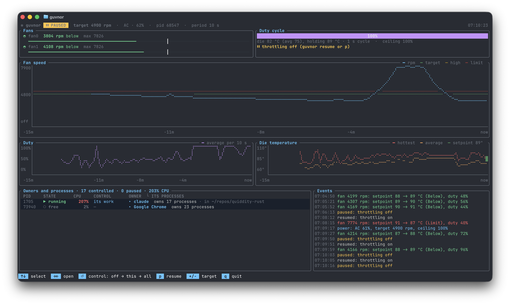

# guvnor

Keeps a Mac's fans at or below a target speed (say 2500 rpm) while heavy background work —
builds, tests, renders — uses as much CPU as that allows. It throttles only the work processes,
never the whole machine: each 10 s period the work runs for `duty × period` and is paused with
SIGSTOP for the rest, and the duty follows the fans.



## How it differs

- **App Tamer** throttles per app to a CPU percentage you choose. guvnor chooses the amount
  itself, from the fans, and finds short-lived build processes as they appear.
- **TG Pro / Macs Fan Control** set fan speeds or curves. They make the fans louder or quieter for
  the same heat; guvnor makes less heat.
- **Low Power Mode** slows everything, including what you are using. guvnor leaves the rest of the
  machine at full speed, and the work runs at normal priority on all cores (performance and
  efficiency) whenever it runs.

## Install

```sh
cargo install --path .        # puts guvnor in ~/.cargo/bin
guvnor config > ~/.config/guvnor/config.toml   # optional: the defaults, commented
guvnor run                    # try it in the foreground first; Ctrl-C continues all work
guvnor install                # then run it as a per-user LaunchAgent (KeepAlive)
guvnor                        # watch it: the live dashboard
```

The LaunchAgent logs to `~/Library/Logs/guvnor.log`. Needs no root: it reads the SMC through
IOKit and only signals your own processes.

## The dashboard

Run `guvnor` with no command in a terminal (like `htop` or `lazygit`); piped or scripted, it prints
`status` instead. It shows:

- in the header, the power source and charge; on AC, the power the adapter delivers against its
  rating; the battery's power (+ charging, − supplying, amber when it drains on AC); the AC
  battery minimum (`keep ≥ 50%`), and, while the adapter is short, the limit on the work;
- each fan spinning at a speed that follows its rpm, on a bar with the target marked, coloured by
  zone: off, base, high, LIMIT;
- how much the work is allowed to run (the duty), and one line saying why: the die temperature
  being held, full speed, or throttling off (the ceiling too, when it is below 100%);
- the fan speed, the duty, the 1-minute load average (against the number of cores) and the die temperature (hottest reading each period, the mean of the die sensors, and the current
  setpoint) over the last hour, starting at 5 minutes and widening as history builds;
- your work grouped by **owner**, one line each, busiest first, with its total CPU and how many of its processes rules already control. An owner is
  what you started: a Claude Code session or a command in a terminal tab (the first process below
  the terminal, login, ssh, tmux and their shell), or an app for its helpers. It shows with its
  current directory, so sessions in different repos are told apart. Under it, as a tree, its
  processes, for owners you open with `→`: those using 1% CPU or more or controlled (running or paused, and what controls them). CPU is averaged over about 10 s, quiet lines stay a minute, and the order holds for 15 s after each key press, so lines do not move while you choose;
  owners using under 5% with nothing controlled are left out;
- the governor's recent events, coloured.

Keys:

- `↑` / `↓` (or `j` / `k`) select an owner or a process; `→` / `←` (or `l` / `h`) open and close an
  owner. `Enter` on an owner cycles it through
  **off → its work → all like it**:
  - **its work**: control everything this owner runs, but not the owner itself (often what you
    interact with). Remembered by pid and start time until it exits.
  - **all like it**: every owner with this name, through `[work] owners` (`claude` covers every
    Claude Code session's work).
  - **off**: neither; rules by name still apply.
- `Enter` on a process cycles it through **off → this → all**:
  - **this**: control just this process, until it exits. Remembered by pid and start time in the
    state directory, so a reused pid is not mistaken for it; the config is not touched.
  - **all**: control every process like it, through a rule in `[work] names`. Versions and cargo's
    hash suffixes count as alike: `python3.14` adds `python[0-9.]*`, `sheets-c15f…` adds
    `sheets-[0-9a-f]{16}`.
  - **off**: removes that rule, or, if another rule still catches the process, adds it to
    `exclude_names`.
- `t` turns throttling off (all work runs freely) or on again; `+` / `-` move the target by 100 rpm; `[` / `]` move the battery minimum on AC (`min_charge_on_ac`) by 5% (from off it starts at 50%, it stays at or below 75%, and below 10% it is off); `e` edits the config in nano (starting from the commented defaults when there is none; on return it says whether the config is valid, since the governor ignores a broken one); `q` quits.

Config changes keep the file's comments, and the governor applies them within a period. With no
governor running the dashboard still shows the fans and your processes.

## Commands

| command | |
|---|---|
| `guvnor` | the live dashboard |
| `guvnor run` | run in the foreground, logging each duty change with the rpm |
| `guvnor status` | the governor's duty, the fans, the power source, the matched processes |
| `guvnor off` | throttling off: every work process continued and left to run freely, until `on` (survives restarts; `pause` also works) |
| `guvnor on` | throttling on (`resume` also works) |
| `guvnor install` / `uninstall` | add / remove the LaunchAgent |
| `guvnor config` | print the default config |
| `guvnor fans` | print the fans, e.g. `fan0 2312/7826 fan1 2495/7826` |

## Configuration

`~/.config/guvnor/config.toml` (or `$GUVNOR_CONFIG`). Every setting is optional; unknown keys are
an error. `guvnor config` prints them all with comments. In short:

- `target_rpm` (2500), `period` (10 s), `control` (`"temperature"`, or `"fans"` for the
  prototype's loop).
- `[temperature]`: `keys` (SMC sensors, `*` for a prefix; default `Tp*`, the CPU dies; `guvnor keys`
  lists them all), `start` (75 °C), `min`/`max` (50–95 °C), `step` (1 °C), `period` (1 s), `kp`/`ki`
  (0.005), `floor` (0.05).
- `[rules]`: above `target + limit_above` (2700) duty × 0.7; above `target + high_above` (2600)
  duty × 0.9; fans off (below 2000) +10 points every 3 periods; at base speed +5 points every 6;
  `floor` 0.2, `ceiling` 1.0; `cut_hold` and `relearn_every` (below).
- `[work]`: which processes are throttled. **Empty by default: nothing is controlled until you
  choose**, in the dashboard or here. `owners` (whole name of an owner's executable: everything
  under it), `names` (whole process name, like `pgrep -x`), `exes` (search
  in the executable's path, e.g. `/(release|debug)/` for anything cargo builds), `cmdlines`
  (search in the whole command line, like `pgrep -f`), `tree_names` / `tree_cmdlines` (that process
  and all its descendants), `exclude_names` (never, whatever else matches), and `idle_below` (1: work using less than 1% of a core over the last 10 s, counting only the time it was let run, is left running, since pausing it saves no heat; a new process is judged by its average since it started; 0 pauses all work). `guvnor config`
  shows examples for Rust, C/C++, Python and media tools.
- `[battery]` (off unless present): `max_duty`, `target_rpm`, `below_charge`, and
  `min_charge_on_ac` (off): on AC, the charge to keep. When the adapter cannot keep up with the
  load (a 65 W charger on a machine that draws more), the battery makes up the difference even
  while plugged in. At or below this charge, while the battery supplies over a watt, guvnor caps
  the work's duty and finds the most the adapter sustains: each period it cuts the cap 5% while
  the battery still drains, and raises it 2% while it charges at over 3 W or is above the
  minimum, letting go once the cap is back at the ceiling. The battery's power is the SMC's
  `SBAP`, smoothed over 20 s (macOS's "charging" only says that the charger is on). The limits
  above stay for battery only. macOS's own holds (optimised charging, the charge limit) stop at
  80% or more, so keep this below 80.

Each period is appended to `trace.csv` in the state directory (about 0.5 MB a day; past 8 MB it
moves to `trace.1.csv`): time, fan speed, target, CPU power (`PSTR`), hottest and mean die
temperature, setpoint, duty, load average and whether throttling was on, a record of how this
machine's fans behave. Four days of it on a Mac17,7 retired an earlier fan model, which predicted
the fans a minute ahead: they act as a thermostat on the die, climbing about 400 rpm per 10 s once
the mean die passes about 91 °C and falling below about 75 °C, within 10 s of the die changing.
Where they will be in a minute depends on load not yet seen; the best model beat assuming no
change by 3.5%. Holding the die below where the fans climb, as the temperature loop does, is what
works.

The governor notices a changed config at the next period and applies it, logging `config
reloaded`. A config with an error is logged and ignored, and the previous settings stay.

## The control loop

These fans are either off or at least about 2500 rpm (base speed reads 2500–2599), so a 2500
target means "base speed is fine, never higher". They follow heat tens of seconds to minutes late,
and they react to the **peak** die temperature, not the average load.

### Temperature (the default)

The prototype (`control = "fans"`) set the duty from the fans directly with a 10 s cycle. On a
heavy parallel build that fails: in each run burst all cores go flat out, the die heats from 55 to
over 90 °C within 2 s, and the fans spin up even at the 20% floor. Measured on the Mac17,7, a
2 s burst at 20% duty held the fans at 5000–6000 rpm.

So there are two loops:

- **A fast loop** (every 1 s cycle) reads the hottest CPU die sensor (`Tp*`) at the end of each
  run phase and adjusts the duty with a PI controller to hold it at a setpoint. Short cycles keep
  the bursts too brief to heat the die, and the die answers within about a second.
- **A slow loop** (every 10 s period) applies the prototype's fan rules to the *setpoint* instead
  of the duty: above LIMIT 4 °C down (and the duty cut by 30% at once), above HIGH 2 °C down, fans
  off or more than 100 rpm below the target 1 °C up every 3 periods, at the target 1 °C up every 6.
  It finds the die temperature at which the fans sit at the target, and follows changes in load
  and room temperature. (At a 2500 target, base speed counts as at the target. At a higher target
  the fans well below it get the fast rise; the slow one is only for probing near it.)

Two details came from live runs. While the fans are falling the slow loop never cuts, even above
LIMIT: the fast loop already has the die under control, and the fans are only shedding old heat.
And only the first cut of an overshoot slows the upward probing (doubling the wait, up to 8×).

Live, under another session's heavy build and test load (around 40 work processes), it brought
the fans from 3576 rpm to base speed in 50 s and held them at 2496–2507 rpm, with the die at
68–77 °C and a duty of 16–30%. The prototype's loop took about 4 minutes to get down and then
overshot to 2778 rpm on its next probe. The governor itself used 0.3% CPU.

### Fans (`control = "fans"`, the prototype's)

Simulated against a fan with that lag, the prototype's rules settle into a limit cycle. The duty
climbs at base speed until the fans pass 2600; then, because the fans keep rising on the heat from
before the cut, it cuts three or four times in a row and climbs again. That gives a cycle of about
6 minutes. Two additions stop it, and `cut_hold = 0`, `relearn_every = 0` turns both off:

- **cut_hold** (4 periods): after a cut, wait before cutting again. Below LIMIT, also only cut
  again if the fans are not already falling.
- **relearn_every** (30 periods): the first cut of an overshoot remembers the duty, and rises stop
  one base step below it. After 30 periods there at base speed it tries one step higher. A try that
  overshoots doubles the wait, up to 8× (40 minutes). With the fans off it tries faster.

### Both

**Pausing together or staggered.** By default all controlled processes run together at the start
of each cycle and pause together, as in the prototype. With `stagger = true` each process gets its
own place in the cycle instead (golden-ratio steps, so they stay spread as processes come and go),
so only about the duty share of them runs at any moment and the power is nearly level. Either way
a process's pause never exceeds `cycle × (1 − floor)`.

Staggering looked better on paper, since these fans react to peak temperature. Measured live on
the Mac17,7 under a heavy build, with the setpoint pinned at 85 °C and the two modes alternated
every 3 minutes (twice each), it was worse: staggered averaged 14.8% duty at 3175 rpm, together
25.4% at 3248 rpm, so pausing together got about 70% more work done for the same fan speed. A
likely reason is that when everything pauses at once the whole chip can idle, which Apple silicon
does efficiently; staggered, some cores are always busy. (One caveat: the SMC updates its sensors
about twice a second, so readings in the synchronised mode may miss the peak. Fan speed, the
quantity that matters, was nearly equal.)

At duty 100% nothing is stopped and the governor does not look for work; it only reads the fans
(and, in temperature mode, the die once a cycle). Work it finds is moved out of the background band
(`taskpolicy -B`), so nothing is left on the efficiency cores only.

**Why not slow the CPU clock instead?** macOS gives no control of Apple-silicon CPU frequencies,
per process or otherwise. The only clock-related levers are Low Power Mode (root, the whole machine)
and background QoS (efficiency cores only), both of which this tool exists to avoid. A 1 s duty
cycle is the per-process equivalent: the die sees the average power.

## Crash safety

If the governor died during a pause, the work would stay stopped for good. Three layers prevent
this:

1. **On start** it continues every matching process, and everything the last governor recorded.
2. **It records every process it may pause** in `~/.local/state/guvnor/stopped.json`, each cycle,
   before sending SIGSTOP. A separate watchdog process (in its own session, so Ctrl-C and terminal
   signals don't reach it) gets a heartbeat over a pipe at least every 100 ms. If the pipe closes
   (the governor exited or was killed) it continues them all at once; if the heartbeat stops for
   a second (the governor hung) it continues them and keeps watching. If both are killed, the
   LaunchAgent's restart continues them, and so does `guvnor status` or `guvnor off`.
3. **Every pause is bounded**: no longer than `cycle × (1 − floor)`: 0.95 s in temperature mode,
   8 s with the fan rules. If the governor hangs, the watchdog continues the work within a
   second of the last heartbeat.

It never pauses itself, its watchdog, its ancestors (your shell and terminal), any `guvnor`,
another user's process, or a process already stopped by someone else (Ctrl-Z).

## Risks

- **Throttled work takes longer in wall-clock time.** Tests with wall-time timeouts can fail, and
  timing benchmarks are meaningless while throttled. Measure work in instructions retired
  (`/usr/bin/time -l`), not wall time, or `guvnor off` first.
- **Rules match broadly.** A rule like `exes = ["/(release|debug)/"]` throttles every build and
  test binary of yours, including ones another session or tool started. The dashboard and
  `guvnor status` list what is controlled and why. `cmdlines` (the prototype's `pgrep -f`) also
  catches shells and scripts that merely mention the text, so prefer `names` or `exes`.
- **A process paused mid-network-exchange** can time out at the other end, as with any SIGSTOP.
- If both the governor and its watchdog are killed while no LaunchAgent is installed (a
  foreground `guvnor run`), work stays paused until you run `guvnor status`, `guvnor off` or
  `guvnor run`, or `kill -CONT` it.

## Uninstall

```sh
guvnor uninstall          # stops the agent (it continues all work) and removes the plist
cargo uninstall guvnor
rm -rf ~/.config/guvnor ~/.local/state/guvnor ~/Library/Logs/guvnor.log
```

## Tests

`cargo test`: both controllers against simulations. The temperature loop holds a simulated die at
its setpoint at light to very heavy loads, and keeps a lagging fan at base speed. The fan rules
converge at a 2500 target, beat the prototype's, and follow load changes. Both cases from the live
runs (a hot start ratcheting the cap or setpoint down) are covered. Also tested: the config, the process matcher, and the crash
safety of the real binary. Those tests kill the governor with SIGKILL mid-pause, kill it together
with its watchdog, hang it with SIGSTOP, stop it with SIGTERM, and use `off`/`on`, checking
each time that no process stays stopped, in both modes. They throttle only their own `sleep`
processes. Stop a running governor before `cargo test`: it would throttle the tests too.

`reference/` holds the prototype (`fan.c`, `fangov.py`) this was ported from.

## Licence

Apache License 2.0: see [LICENSE](LICENSE).
